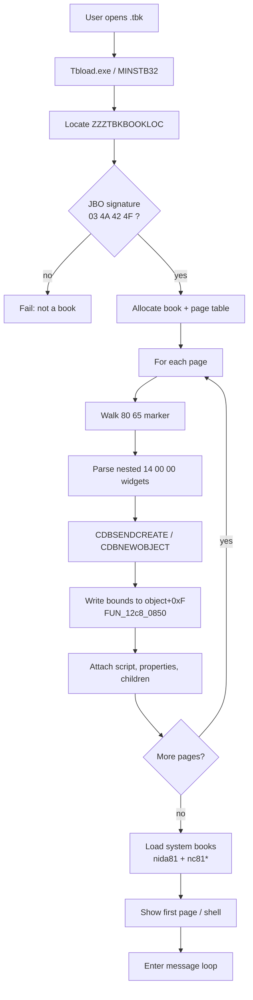
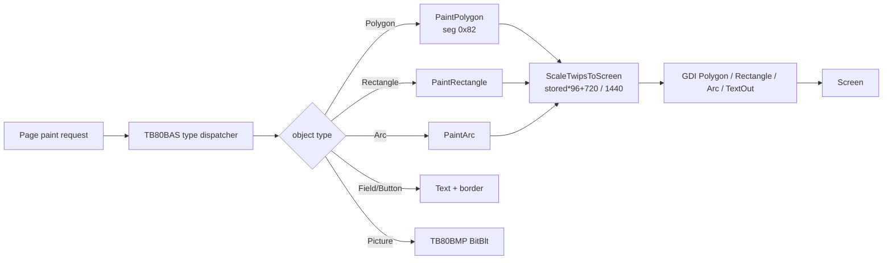

# Chapter: ToolBook 8 Architecture, Flow, and Pseudocode

This chapter describes the runtime architecture recovered from the ToolBook II 8.1 / TB80 NE binaries, the Nida ATT course books, SoftICE sessions, and Ghidra analysis. It focuses on the native (non-DHTML) path used by the lesson `.tbk` files.

## 1. High-Level Architecture

ToolBook is an interpreted, object-oriented, event-driven system built around a book metaphor.

```
┌─────────────────────────────────────────────────────────────────┐
│                        .tbk Book File                           │
│  PE stub (0xC00) + ZZZTBKBOOKLOC + JBO body                     │
│  Pages: 80 65 records containing nested 14 00 00 widgets        │
└────────────────────────────┬────────────────────────────────────┘
                             │ open
                             ▼
┌─────────────────────────────────────────────────────────────────┐
│                     TB80RTM.EXE (engine)                        │
│  Book loader, page table, message dispatch, window classes      │
│  (TBKMain, TBKClient, SchedulerWndTB80, …)                      │
└───────┬──────────────┬──────────────┬──────────────┬────────────┘
        │              │              │              │
        ▼              ▼              ▼              ▼
   TB80BAS.DLL    TB80CMP.DLL    TB80BMP.DLL    TB80UTL.DLL
   objects,       OpenScript     bitmaps,       type table,
   properties,    bytecode,      DIB, palette   object names
   painters,      keyword pool                  (Page, Polygon,
   scale twips                                  Field, …)
        │
        ▼
   Live objects (bounds at +0xF, geometry, scripts)
        │
        ▼
   GDI (Polygon, Polyline, Rectangle, Arc, TextOut, BitBlt)
        │
        ▼
   Screen

System books (nida81.tbk, nc81base.sbk, nc81recs.sbk, nc81test.sbk,
nc81trnr.sbk, tb80r.sbk) supply shell pages, path manager, quiz
helpers, and shared resources. They are loaded by the engine.
```

<grok type="render_generated_image" prompt="Clean technical architecture diagram of ToolBook 8 runtime" orientation="landscape" />

**Key modules (16-bit NE unless noted):**

| Module       | Role |
|--------------|------|
| TB80RTM.EXE  | Main engine, book open, windowing, message loop |
| TB80BAS.DLL  | Object model, property get/set, painters, twip scale |
| TB80CMP.DLL  | OpenScript compiler/expander, keyword resources 0x77/0x78 |
| TB80BMP.DLL  | Bitmap load, DIB creation, graphic effects |
| TB80UTL.DLL  | Object classification table, utilities |
| TB80W16.DLL  | 16-bit thunks / graphics helpers |
| nida81.tbk   | Shared shell (menus, splash, system pages) |
| nc81*.sbk    | System books (resources + limited logic) |
| nc81int.dll / nc81rec.dll | 32-bit PE: trainer hardware + session recording |

## 2. Book File Layout

```
Offset 0x0000   PE/MZ stub (0xC00 bytes, no useful code)
Offset 0x0C00   ZZZTBKBOOKLOC marker + magic 0x22222222
                followed by JBO signature: 03 4A 42 4F 01 00 00 08
                then book header, page directory, page records
```

- Page objects are the only records starting with `80 65 00 05 00 02 02`.
- Inside a page, widgets are nested chunks starting `14 00 00`.
- Property blocks frequently begin `14 00 00 01`.
- Standard property IDs (from TB80BAS resource):  
  bounds=0x4004, text=0x402e, script=0x4023, vertices=0x4034, idNumber=0x4015, …

## 3. Book Open Sequence



<grok type="render_generated_image" prompt="Flowchart of ToolBook book open sequence" orientation="landscape" />

### Pseudocode: Book Open

```text
function openBook(path):
    h = CreateFile(path)
    loc = findZZZTBKBOOKLOC(h)          // offset of real body
    if read(h, loc, 4) != "JBO\x03" and version != 0x00000008:
        return error("Not a book")

    book = allocBook()
    book.file = h
    book.base = loc

    pageCount = readPageDirectory(book)
    for i in 0..pageCount-1:
        pageRec = readPageRecord(book, i)   // starts with 80 65 …
        page = createPageObject(pageRec)
        book.pages.append(page)

        // widgets live inside the page record
        for widgetChunk in nestedChunks(pageRec, marker=0x14 0x00 0x00):
            obj = CDBNEWOBJECT(widgetChunk)
            // FUN_12c8_0850 equivalent:
            obj.bounds = extractBounds(widgetChunk)   // stored at object+0xF
            obj.type   = classify(widgetChunk)        // via TB80UTL table
            obj.props  = parseProperties(widgetChunk)
            obj.script = extractScript(widgetChunk)   // bytecode
            page.children.append(obj)

    loadSystemBooks(["nida81.tbk", "nc81base.sbk", …])
    showPage(book.pages[0] or shellPage)
    return book
```

## 4. Object Model and Painting

Hierarchy (classic ToolBook):

```
Book
 └── Background(s)
      └── Page(s)
           └── Widget(s)  (Field, Button, Polygon, Rectangle, Arc, Picture, Group, …)
```

Live object (simplified, from BAS painters and SoftICE):

```
object {
    type          // at object-2 or similar
    bounds        // left, top, right, bottom in twips at +0x0F
    fillColor     // dword
    // type-specific:
    // Polygon: count at +0x30, point array far ptr at +0x32 (x,y twips)
    // Arc: four twip pairs at +0x25..+0x33, angles
    script        // OpenScript bytecode
    properties    // id → value
    children
}
```

### Painting Pipeline



### Pseudocode: Polygon Paint (recovered)

```text
function PaintPolygon(obj):
    count = word(obj + 0x30)
    pts   = farptr(obj + 0x32)          // count * 4 bytes of x,y twips
    screenPts = alloc(count)
    for i in 0..count-1:
        screenPts[i].x = ScaleTwipsToScreen(pts[i].x)
        screenPts[i].y = ScaleTwipsToScreen(pts[i].y)
    fill = color(obj)
    GDI.Polygon(screenPts, count)       // or PolyPolygon
    // caller may also stroke
```

```text
function ScaleTwipsToScreen(twips):
    // DS:01A6 / DS:01A8 normally 96
    return (twips * dpi + 720) / 1440
```

On disk, polygon records (kind `04 00` inside `14 00 00`) store the point count and twip pairs directly; the runtime copies them into the object via the property 0x4050 / SetPointArray path.

## 5. OpenScript

- Bytecode lives in page/widget records.
- Keyword pool: NE resources 0x77 / 0x78 in TB80CMP (~1000 strings).
- Encoding (simplified):
  - 0x00–0x7F: literal
  - 0x80–0xBF: keyword index (+ optional space)
  - 0xC0–0xFF: back-reference into the compressed stream
  - 0xE0–0xEF: CRLF + spaces, etc.
- Handlers are event-driven (`buttonClick`, `enterPage`, `mouseEnter`, …).
- Messages walk the hierarchy (object → page → background → book) unless forwarded.

### Pseudocode: Handler Dispatch (conceptual)

```text
function send(message, target):
    handler = findHandler(target.script, message)
    if handler:
        executeBytecode(handler, target)
        if not forwarded: return
    if target.parent:
        send(message, target.parent)     // bubble
```

Example recovered handler text:
```
to handle buttonClick
  go to page "P400"
end
```

## 6. System Books and Navigation

- `nida81.tbk`: shell pages (menus, splash, minimum requirements, test console).
- `nc81base.sbk`, `nc81recs.sbk`, `nc81test.sbk`, `nc81trnr.sbk`: resource containers + helpers (path manager, quiz, recording).
- Lessons call into them (`initializebase`, `openSession`, `gotoPageList`, `go to page "P310" of book "nida81.tbk"`).
- Cross-book jumps are resolved by the engine’s book table.

## 7. What Is Solid vs. Still Open

**Solid**
- File markers, page/widget chunking, property ID table
- OpenScript bytecode decoder and many handlers
- Polygon on-disk layout + live paint path + twip scale
- High-level open sequence and module responsibilities
- Text, navigation, and quiz extraction for lessonshell-style readers

**Still open / partial**
- Exact instruction sequence that reads a generic `14 00 00` record and fills `object+0xF` (the Ghidra name `FUN_12c8_0850` is only a label)
- Full layouts for Arc, Curve, Picture placement, and non-polygon draw objects
- Complete OpenScript virtual machine (current readers handle the navigation/quiz subset)
- Binding every carved BMP to its page widget

## 8. How This Maps to the Modern Readers

The clean-room players (Maybe2/4, Brickwall `tbk_gui`, `runtime/`) implement:

1. Walk `80 65` pages and `14 00 00` chunks.
2. Extract text properties and quoted page jumps.
3. Decode OpenScript for `go to page` / `send next` / quiz logic.
4. Render polygons where the kind=`04 00` layout is known.
5. Stub system-book services (path manager, session).

They deliberately do not re-implement the full 16-bit NE engine. The architecture above is what they approximate.

---

*Diagrams generated from the recovered model. Mermaid source is in this file and can be rendered by any Mermaid-capable viewer.*
