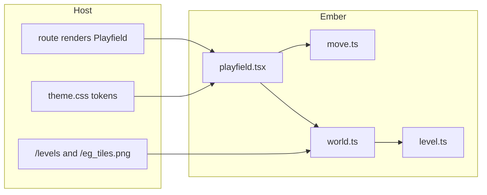
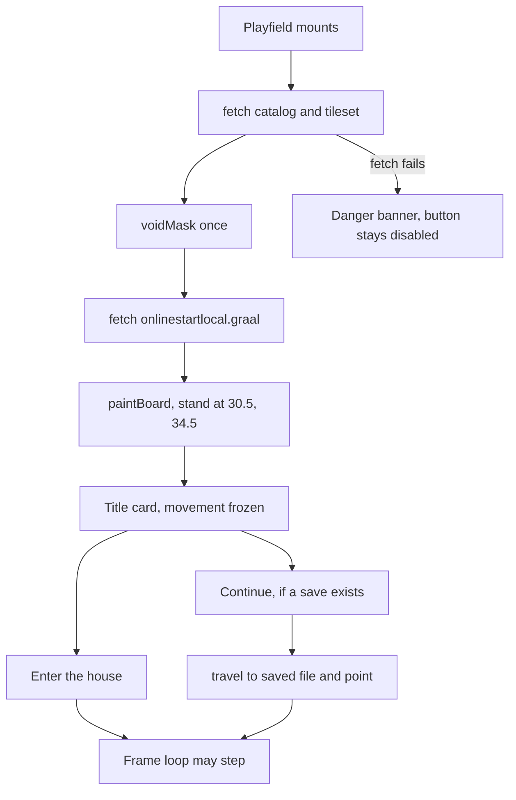
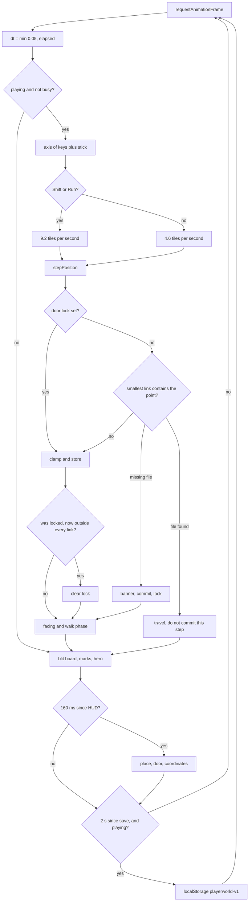
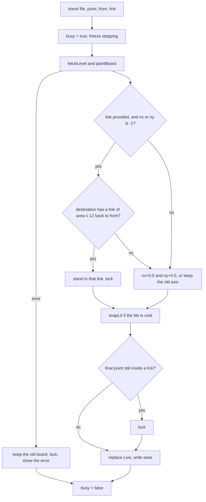
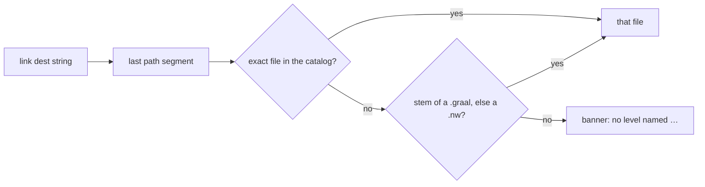
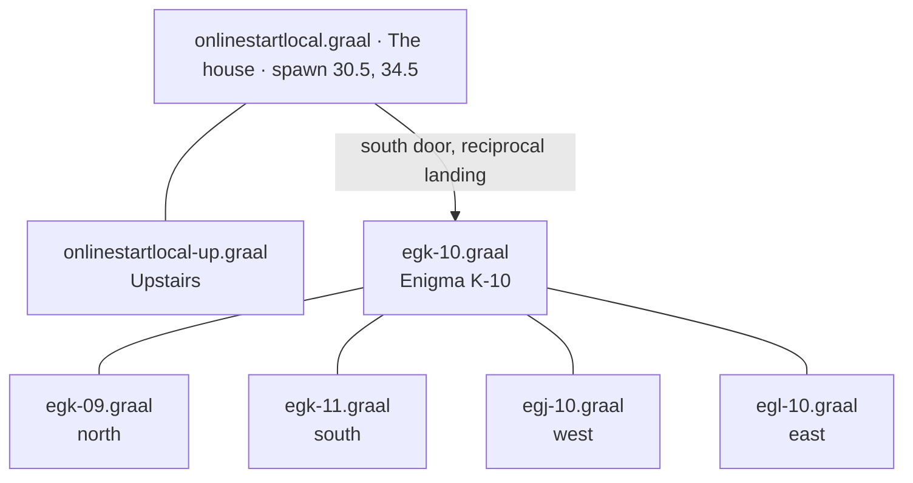
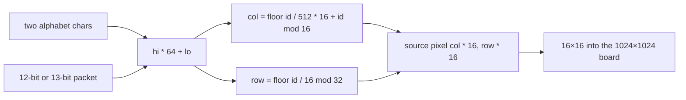
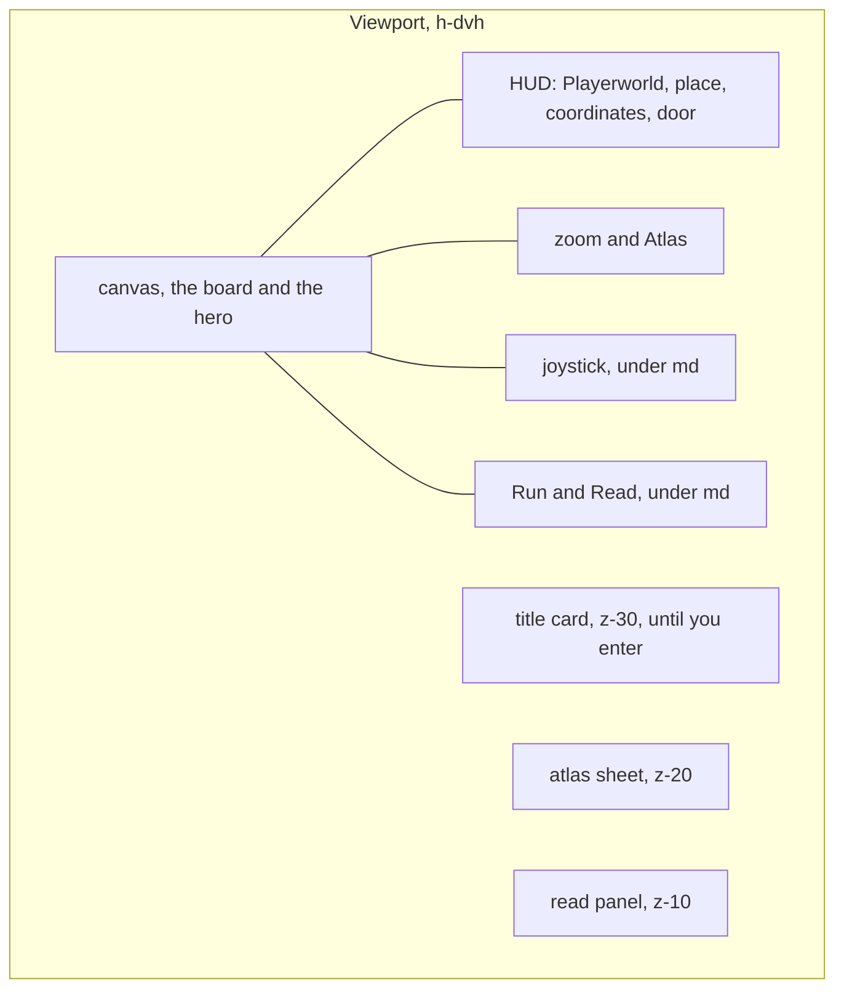

# Diagrams

The prose for each of these is in [Framework](framework.md), [Architecture](architecture.md), [Levels](levels.md), and [Runtime](runtime.md).

## Modules

## Boot and the title card

## One frame

## Door travel

## Where a link sends you

The rectangle test, before that lookup: among links that contain the point, the smallest `w * h` is the one that fires.

## Overworld around the start

The grid is `eg{a–y}-{01–25}`, columns A–Y, rows 01–25. You do not spawn on it. You spawn in the house, and the south door is the edge into K-10.

Edge links on the overworld usually name the neighbor and a real `nx` or `ny`. Those use the explicit landing, not the reciprocal search. The reciprocal search is for a small door that left an axis as `-1`, which is the house door.

## Tile id to a cell

Void is not a special id. After the tileset is decoded, any of the 8192 cells whose sampled pixels average below 8 is marked empty, and `snapLit` will not leave you standing on it when a level opens.

## Screen

The title card covers the board until Enter the house or Continue. The atlas covers it while you search. The read panel does not. You can still see the room behind a sign.