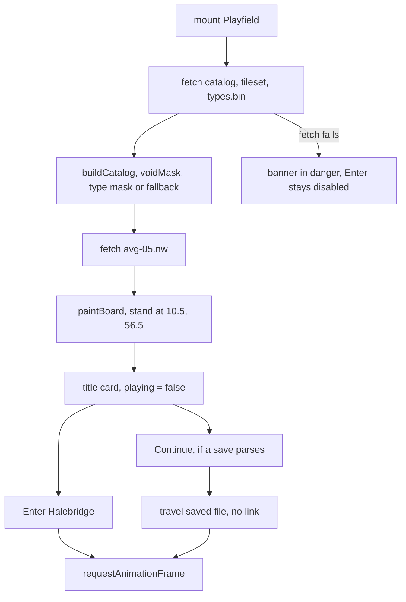
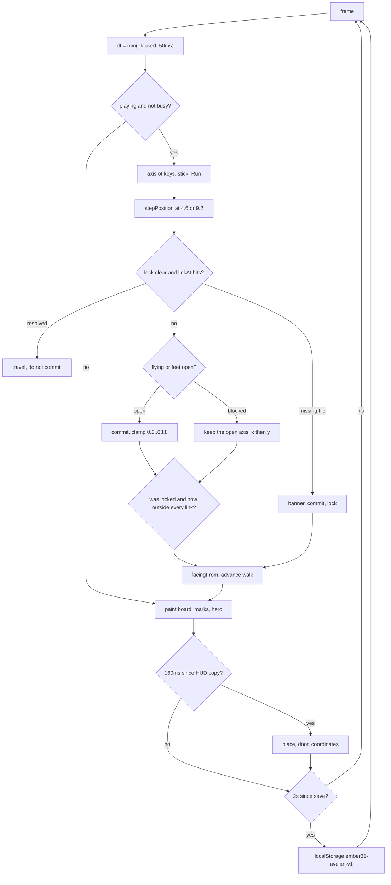
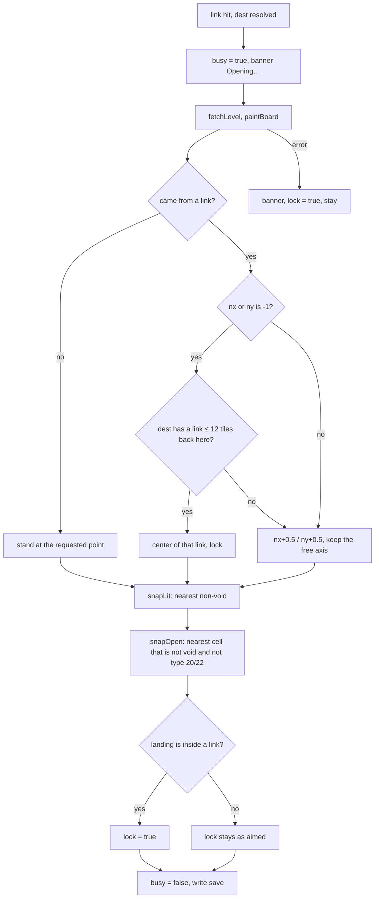
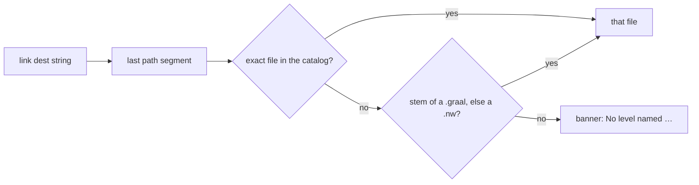
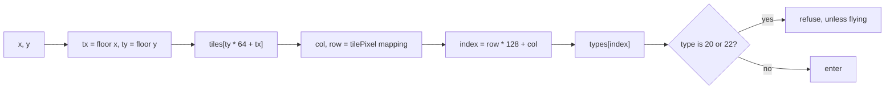
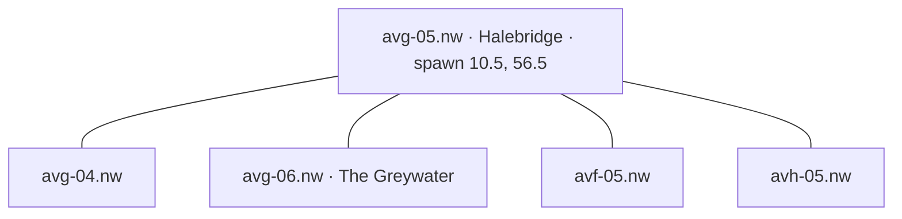
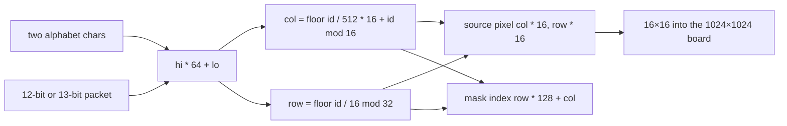
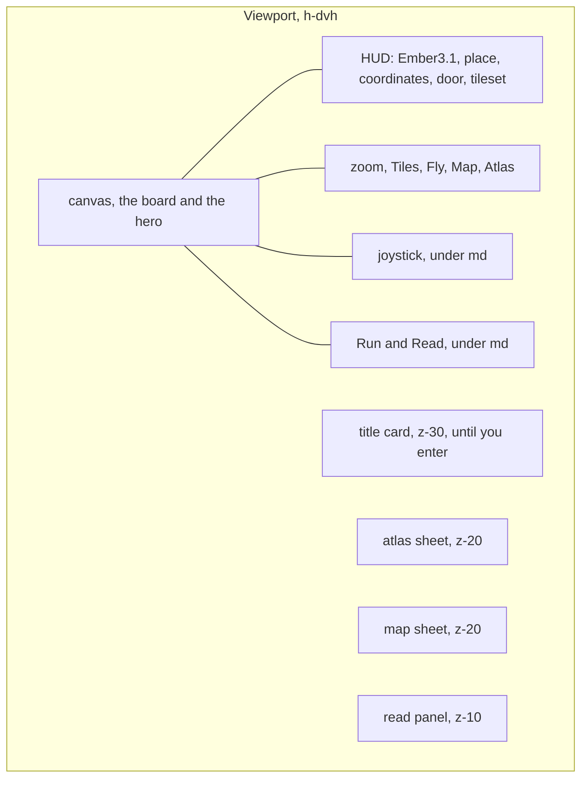

# Diagrams

The same system as [Architecture](architecture.md) and [Runtime](runtime.md), drawn.

## Boot

## One frame

## Opening a door

## Where a link sends you

The rectangle test, before that lookup: among links that contain the point, the smallest `w * h` is the one that fires.

## Feet against the mask

Void is a different test, and only on arrival. After the tileset is decoded, any of the 8192 ids whose sampled pixels average below 8 is marked empty. `snapLit` will not leave you standing on it when a level opens. Uploading a sheet rebuilds this mask and the board. It does not rebuild `types`.

## Avelan around the start

The grid is `av{a–j}-{01–10}`. You spawn in Halebridge, south side of the keep. The south gate is the edge out. Neighbor files depend on the link written in `avg-05.nw`; the usual overworld pattern is the four adjacent cells.

Named places elsewhere on the island: Highcairn `avf-03`, Westmere `avd-06`, Saltwharf `avf-09`, Cinderholm `avi-08`. The map pins those six. They are labels, not warps. Warping is the atlas.

## Tile id to a cell

## Screen

The title card covers the board until Enter Halebridge or Continue. The atlas and the map cover it while they are open. The read panel does not. You can still see the room behind a sign.