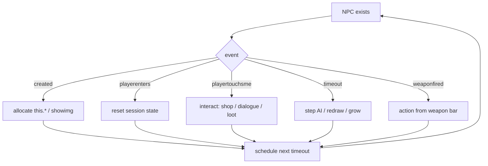

# Event model

## Dictionary

| Event | When | Typical use |
|---|---|---|
| `created` | NPC first appears | one-shot init, allocate images |
| `playerenters` | player walks into level | reset local state, show welcome |
| `playertouchsme` | player walks onto the NPC tile | open shop, start dialogue, pickup |
| `playerchats` | player says something nearby | chat command, NPC reply |
| `timeout` | scheduled wake-up | AI step, HUD redraw, growth tick |
| `weaponfired` | player uses the weapon this script is pinned to | fire projectile, swing |
| `keydown` | key pressed while this NPC is focused or global | menu navigation |

## Dispatch flowchart

## Notes

- Most scripts set `timeout` at the end of every handler so the loop continues.
- `if (timeout)` is the usual guard; some scripts also check `timeout == 0` to stop.
- Weapon scripts often ignore level events once `isweapon` is true.
