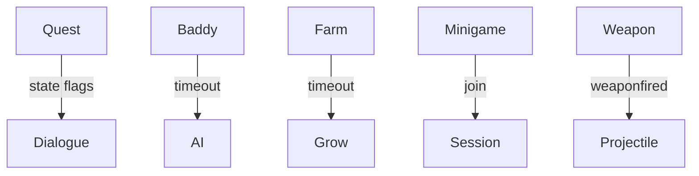

# Phoenix pack architecture

Quests, dungeon props, baddies, minigames, farm, weapons.

## Blueprint

## Live loop

Quest dialogue is a state machine driven by `playerchats` and flags in `client.*` or `save[]`. Baddies run a seek/attack/roam loop on timeout. Farm crops grow on a slow timeout and can be harvested on touch. Minigames allocate a session NPC on join.

See `quest-dialogue.md`, `baddies.md`, `farm-berry.md`, `minigames.md`, and `weapons.md` for details.
