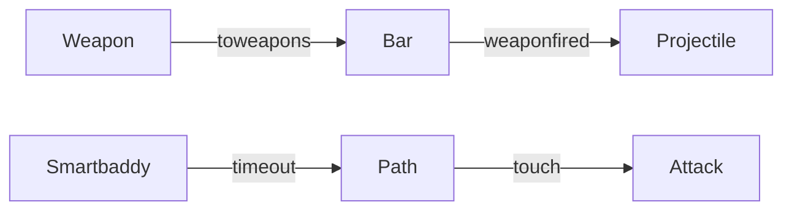

# Meh pack architecture

Ace2896 weapons and smartbaddy AI.

## Blueprint

## Algorithms

- Hookshot / cbow: fire a put-NPC projectile that travels until hit or timeout
- Smartbaddy: simple A* or waypoint pathing toward player, attack when adjacent

See `smartbaddy.md` and `weapons-hookshot-cbow.md`.
