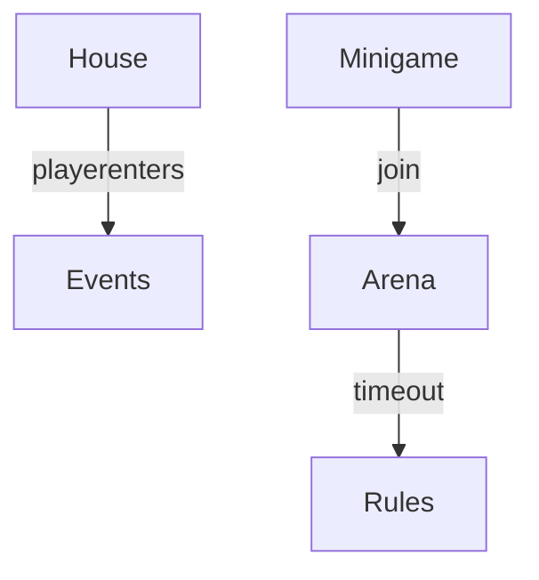

# Ultimate NPC Pack architecture

Agret houses, pacman, warzone, bomberman, CTF, player events.

## Blueprint

## Notes

Large community pack. Many level props and triggers. Minigames follow a join/session/end pattern. Player houses use event scripts for furniture and visitors.

See `minigames.md` and `playerhouse-and-events.md`.
