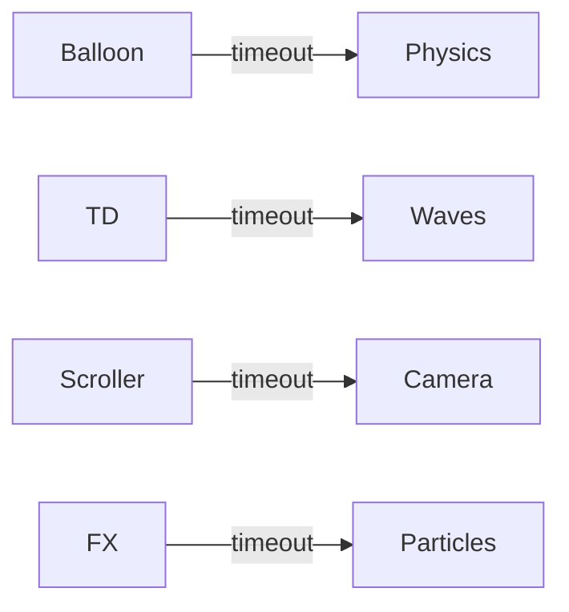

# Standalone pack architecture

Balloon Fight, tower defense, TRPG, qmenu, scrollers, FX, farm server, etc.

## Blueprint

## Notes

These are self-contained demos and minigames that do not depend on the larger packs. Each has its own loop and state.

See individual files for balloon-fight, tower-defense, rpg-battle, side-scroller-parallax, visual-fx, etc.
