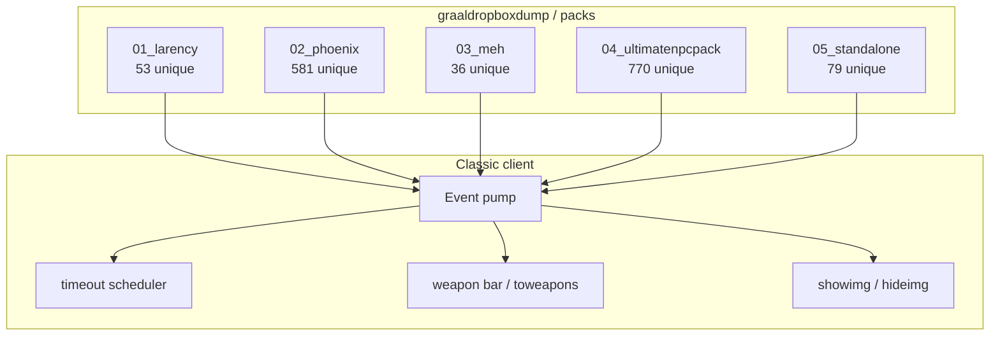

# Ash — NPC architecture, blueprints, algorithms

Standalone architecture sections for the Graal Classic dump extracted in `Grokd/` and annotated in `Phoenix/`.

Body-hash still matches `Grokd/CATALOG.tsv`. These files do **not** reprint script bodies; they document control flow, data, and algorithms.

```
1520 unique script bodies
6275 scripted placements
5 packs
```

## How to read this folder

| Path | What it is |
|---|---|
| `00-runtime/architecture.md` | Client NPC runtime: events, `timeout`, `toweapons`, images, flags |
| `00-runtime/event-model.md` | Event dictionary + dispatch flowchart |
| `00-runtime/state-and-ids.md` | `this.*`, `client.*`, `save[]`, showimg ID bands |
| `01-larency/` | tricxta HUD / inventory / shop / lockpick / ranger |
| `02-phoenix/` | Quests, dungeon props, baddies, minigames, farm |
| `03-meh/` | Ace2896 weapons + smartbaddy AI |
| `04-unp/` | Ultimate NPC Pack (Agret houses, pacman, warzone, bomberman, CTF) |
| `05-standalone/` | Balloon Fight, tower defense, TRPG, qmenu, scrollers, FX |

Each section has the same skeleton:

1. Blueprint (who talks to whom)
2. Architecture diagram
3. Flowchart of the live loop
4. Algorithms
5. Pseudocode
6. Gotchas

## Pack map



## Classification across 1519 documented scripts

| Class | Count | Typical home |
|---|---|---|
| quest / dialogue | 516 | Phoenix |
| level prop / trigger | 390 | UNP + Phoenix |
| farm / planting | 136 | Phoenix + farm server |
| player weapon / projectile | 135 | Meh + UNP + standalone |
| shop / merchant | 111 | UNP + larency + scroller |
| minigame | 59 | UNP + Phoenix + TD |
| enemy / baddy AI | 44 | Meh + Phoenix + larency |
| inventory / equipment UI | 37 | larency + qmenu |
| HUD / stats overlay | 20 | larency + scroller + TD |
| loot / chest | 15 | larency |
| visual FX | 10 | snow, shadowCast, warp |
| other (warp, pet, lock, map, tileanim) | ~24 | mixed |

## Authors that show up in headers

`tricxta` / `Tricxta` (~468), `The` (158), `Ace2896` (37), `Stefan` (36), `Birdbird_0` (35), `Scotty` (34), `Agret` (27), plus a large untagged community pile in UNP.

## Source of truth

- Extracted bodies: `artifacts/Grokd/packs/*.npc.txt`
- Annotated copies: `artifacts/Phoenix/packs/*.documented.npc.txt`
- Occurrence index: `artifacts/Grokd/CATALOG.tsv`
